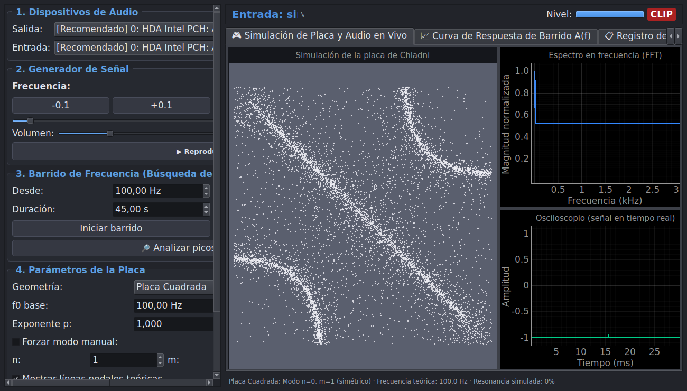

# Laboratorio de Figuras de Chladni — Acústica y Placas Vibrantes

Software interactivo de instrumentación acústica, análisis espectral (FFT) y simulación física de patrones nodales de Chladni en placas cuadradas y circulares. Compatible con **Windows** y **Linux**.



## Características Principales

- **Generador de Tonos y Barridos en Tiempo Real**: Síntesis senoidal continua con microajustes (`±0.1 Hz`, `±0.01 Hz`), rampas anti-clic, limitador suave y barridos automáticos (lineales o logarítmicos, ida o ida y vuelta).
- **Analizador Espectral FFT y Osciloscopio**: Captura en vivo mediante búfer circular sin bloqueos, ventana de Hann, *zero-padding* `x4` e interpolación parabólica logarítmica (precisión `< 0.05 Hz`), detección de nota musical en centésimas (`¢`) y alerta de saturación (`CLIP`).
- **Simulación Física Vectorizada**:
  - **Placa cuadrada**: Ley de Chladni-Ritz para modos simétricos y antisimétricos $f(n,m) = f_0 (n^2 + m^2)^p$.
  - **Placa circular**: Funciones de Bessel $J_m(\alpha_{m,n} r)\cos(m\theta)$.
  - **Asistente de calibración por mínimos cuadrados**: Ajusta $f_0$ y el exponente $p$ a partir de las resonancias medidas en tu placa real.
- **Registro Experimental**: Comparación con afinador externo, cálculo de error relativo porcentual, exportación a CSV y captura de figuras en PNG.

---

## Uso en Windows

### Opción rápida (1 clic)
Ejecuta **`iniciar_windows.bat`**. Si es la primera vez que lo abres en ese portátil, creará automáticamente el entorno virtual `.venv`, instalará las dependencias y abrirá la interfaz gráfica.

### Opción manual por terminal (PowerShell)
```powershell
python -m venv .venv
.\.venv\Scripts\python.exe -m pip install -r requirements.txt

# Ejecutar pruebas del núcleo matemático y DSP
.\.venv\Scripts\python.exe test_core.py

# Ejecutar autodiagnóstico de audio
.\.venv\Scripts\python.exe -m chladni_lab --selftest

# Abrir la interfaz gráfica
.\.venv\Scripts\python.exe chladni_lab.py
```

---

## Uso en Linux (Linux Mint / Ubuntu / Debian)

```bash
sudo apt install python3-venv libportaudio2
python3 -m venv .venv
source .venv/bin/activate
pip install -r requirements.txt

# Ejecutar pruebas y abrir la aplicación
python test_core.py
python chladni_lab.py
```
